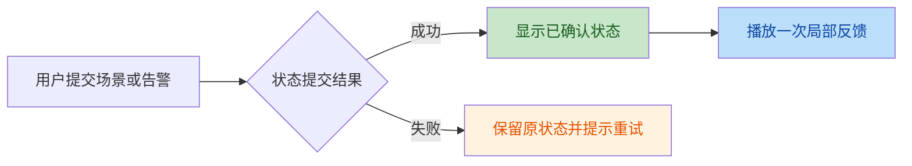
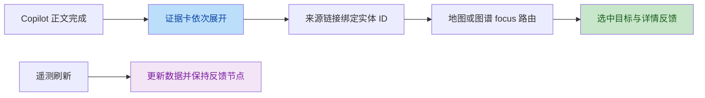

# 四项交互反馈审查

范围：设备定位、场景交接、告警状态流转、Copilot 证据联动。保留纯 CSS/rAF，不改变仿真公式与告警排序，不动画 MapLibre Marker 根定位。

## 行为链路

## 独立代码复核与修复

两份独立审查均确认以下三项，并在修复后复核通过：

| 问题 | 修复 | 防回归证据 |
|---|---|---|
| 数字组件嵌套 span 命中标签样式，数字缩小变暗 | `.env-param > span` 只作用于标签 | 浏览器检查数字继承 10px |
| UAV-01/02 共享移动标记，互切时定位环不重播 | 按实际 selectedId 比较，仅替换子环 | 遥测后旧节点保持连接，互切后断开，新环结束 opacity=0 |
| 切换动态/告警标签会重播旧成功反馈 | 620ms 清理，切标签同步清空 | 切回后无 confirmation 元素 |

人工页面审查另发现场景提示覆盖平板标题，已移至底部，手机避开导航与安全区。浏览器测试曾误以为 cloneNode 不会复制测试属性，已改为验证真实节点连接状态。

## 验证入口

`npm run test:all` 使用专用 `iot_regression_test` 数据库与 :8020/:4175/:4176 临时实例。新增场景请求锁与失败重试的单元测试，浏览器覆盖成功/失败反馈、定位、静态动效、三尺寸两主题截图。截图输出 `output/playwright/interaction-*.png`，按 DESIGN.md 人工查看；详细覆盖范围与外部依赖边界见 TESTING.md。

## 最终结果

- `npm run test:all` 完整通过：前端 185、后端 146、Chromium 24，共 355 项；类型、构建、覆盖率门槛与文档漂移检查均通过。
- 三尺寸两主题的场景/证据页面截图已人工检查；地图另用 :4177 本地预览加载真实影像并检查设备定位环，以及桌面、平板浅色、手机浅色布局。场景提示避开标题和底部导航，证据链接未被其他浮层遮挡。
- :8000 演示实例健康，PostGIS/MQTT 正常；临时测试与人工预览使用独立端口，完成后关闭。
