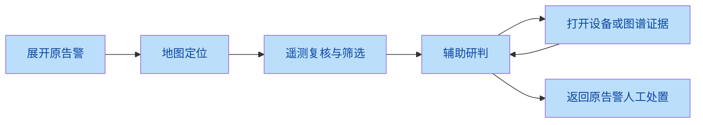
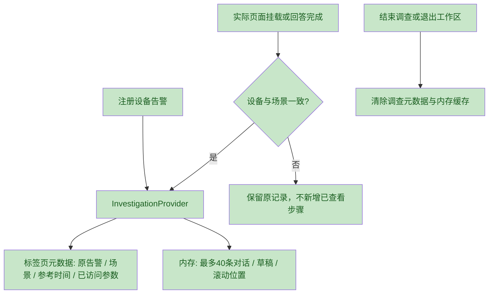

# 告警调查与阅读层级审查

范围：a31c161 之后的前端调查上下文、Copilot 内存恢复及排版改动。目标是让值班人员看完证据后回到原告警，普通正文和真实警示有清晰区分。未增加后端写接口，仿真公式、权限、LLM 系统提示与动效契约沿用现状。

## 独立审查与修复

两路独立排版评估均指出：普通设备名/正常读数/回答正文过度使用暖色，证据字号偏小。机械 type 检测未报告命中（CSS 选择器覆盖有限），结合源码选择器与人工页面判断。正文13px，辅助11–12px，标题12–13px/600；纯 HUD 和图表刻度继续紧凑。warning/critical 状态专用色未删除。

交付前两路独立代码审查复核了全部当前改动，发现并修复：

1. 350ms 自动提问到期前跳走会丢失问题：使用 scheduledQueryRef 保留为草稿，返回不自动重复请求；待回复跳走同样保存问题草稿。
2. 场景变化后同设备数据误记入原调查：recordView 同时校验设备与场景，异场景不计完成。
3. 调查条只按路由高亮误导设备上下文：加入设备查询及场景约束。
4. 人工页面审查发现手机表格标题被工具栏挤成竖排：标题与工具栏换行，表格使用自然高度，仍保留内部横向滚动。
5. 844×390 下调查条挤占聊天正文：仅在调查条存在且高度≤560时保留320px聊天面板，外层滚动，正文高度断言>100px。

两路复查确认上述问题闭环，未发现新的阻断问题。会话正文不写 sessionStorage；刷新仅恢复导航元数据，不恢复对话。参考时段固定于调查开始，只是记录，不承诺历史遥测回放。

## 验证

- 已人工打开告警详情、设备表格/设备详情、Copilot 长证据与输入区截图，覆盖 390×844、768×1024、1024×768、1440×720、844×390，检查两主题、正常正文与警示状态、控件可达、长文本换行与滚动。
- 截图位于 `output/playwright/investigation-*.png`（五尺寸两主题、输入区及表格），补充 `reading-alert-*` / `reading-table-*` / `reading-inspector-*`（三尺寸两主题）。截图按仓库规则不入库，测试可复现生成。
- 独立复查确认两处响应式修复与标题高度、首行可达、聊天正文高度断言匹配。
- 最终 `npm run test:all` 完整通过：前端189、后端146（真实 PostGIS 集成未跳过）、浏览器32，共367项；类型检查、生产构建、覆盖率门槛与文档漂移检查均通过。新增调查回归8/8通过。
- 门禁发现既有 WS 认证测试可能收到登出前已缓冲的周期广播帧。该用例仅暂停独立周期广播，仍走真实 ASGI/数据库并严格验证首次快照、票据防重放及登出关闭码4401；广播行为已有独立生命周期测试覆盖。没有增加自动重试或弱化断言，生产后端未改。
