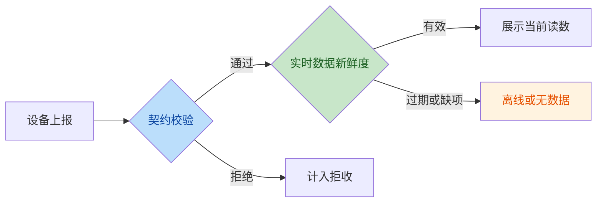
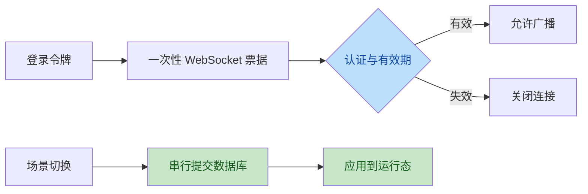

# 实时遥测与安全修复审查

本轮检查实时设备上报、会话有效期、场景切换和飞控对象校验，以及缺失遥测在前端的呈现。审查中发现并修复了 WebSocket 首帧的认证竞态、场景提交期间取消请求导致内存与数据库不一致、图表删除设备后保留旧序列和图表序列 ID 不稳定等问题。修复经过独立代码复核和针对性回归；浏览器截图需按 DESIGN.md 人工审查。

- MQTT 设备账号须由部署者在 broker 配置中限制为仅可写自己的设备主题；已有通配 ACL 不会自动迁移。隔离 TLS broker 回归验证跨设备读写被拒绝。
- WebSocket 票据与连接均受原登录令牌到期时间约束；登录失效后不得再广播。
- 拒绝可能使汇总溢出的极端数值；接收模式按单设备最后到达时间判断离线，缺失指标和历史间断不再显示为零。演示模式保留既有仿真语义。
- 场景和仿真状态变更先提交再应用，并在请求取消时完成正在进行的提交与应用。飞控航线和计划校验真实存在且类型受支持的设备。
- 前端实时单点图显示真实设备读数；无数据时显示占位，Copilot 不将缺失字段描述为零。模拟模式的演示内容保持原样。
